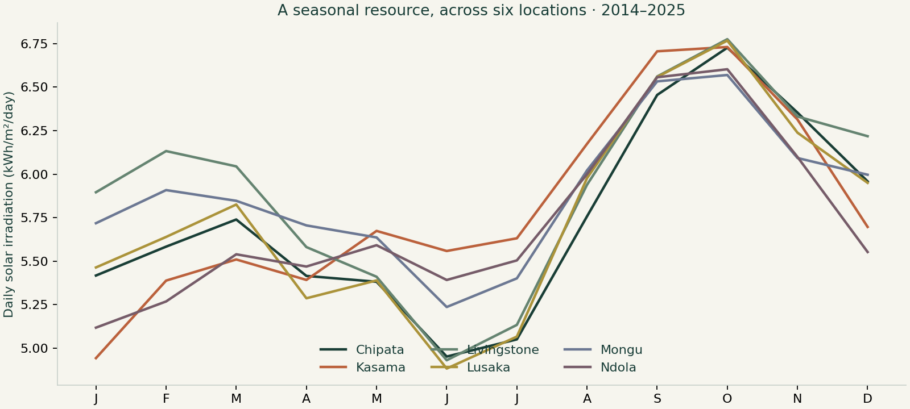

# Zambia Solar Resource Observatory

[](https://github.com/GovernorKaputula/zambia-solar-resource/actions/workflows/verify.yml)

**[Explore the application](https://governorkaputula.github.io/zambia-solar-resource/)** · [Read the study](reports/study.md) · [Methods and source data](DATA_SOURCES.md) · [Full portfolio](https://governorkaputula.github.io/data-science-portfolio/)

An independent investigation of seasonal solar resources and forecast reliability at six reference locations in Zambia. The project combines electrical-engineering context with data acquisition, temporal validation, uncertainty assessment, SQL auditing, and a browser-based explorer.

**The central result:** complexity did not earn its place. A seasonal harmonic model won validation, but its final MAE was **0.760 kWh/m²/day**, compared with **0.755** for monthly climatology. Intervals targeting 80% coverage reached **75.7% overall** and **60.7% in November–April**. The limitations are part of the finding.



## What you can inspect

- **26,298 daily location records:** NASA POWER GHI and temperature, 2014–2025; exact request URLs, cached responses, and SHA-256 checksums.
- **Six locations:** Lusaka, Livingstone, Ndola, Chipata, Kasama, and Mongu.
- **Five candidate model families:** monthly climatology, seasonal harmonics, delayed-input ridge, and two boosting configurations.
- **Separate time periods:** model selection in 2021–2022, uncertainty calibration in 2023, final evaluation in 2024–2025.
- **Availability-aware features:** non-calendar inputs end at t−8, with the publication-latency assumption and revised-data limitation documented.
- **Interactive evidence:** compare locations, switch monthly/annual views, inspect error by month, export results, and explore a clearly labeled energy scenario.
- **Automated verification:** source integrity, future-input perturbation checks, calibration reconstruction, saved-output reconciliation, and independent SQL summaries.

## Reproduce

Python 3.12 was used for the verified run. The standard pipeline reads the six committed NASA source snapshots; it does not call the live API.

```sh
python -m venv .venv
# Windows PowerShell: .venv\Scripts\Activate.ps1
# macOS/Linux: source .venv/bin/activate
python -m pip install -r requirements.txt
python -m src.analysis
python -m unittest discover -s tests -v
python scripts/sql_audit.py
python build.py
python scripts/check_site.py docs
python -m http.server 4174 --directory docs --bind 127.0.0.1
```

Open `http://127.0.0.1:4174`. The static application uses local assets and embedded analytical outputs. It has no API keys, remote scripts, or usage tracking. GitHub Actions runs the analysis and checks on every push and pull request.

To acquire data in a fresh checkout without snapshots, run `python -m src.data`; existing files are deliberately reused. To study a revised source version, make a separate copy, remove its cached responses and provenance, acquire once, and compare versions. Do not silently overwrite the published benchmark's snapshots.

## Research decisions

| Decision | Why it matters |
| --- | --- |
| Preserve a final two-year holdout | Model selection cannot benefit from the final results. |
| Keep the monthly baseline | Small validation gains can disappear in later years. |
| Fit preprocessing inside each training slice | Scaling cannot learn from later data. |
| Use an eight-day feature cutoff | Same-day historical weather is not a usable live forecast input. |
| Calibrate before the holdout | Test outcomes do not determine interval widths. |
| Report seasonal coverage | An aggregate number can conceal poor reliability in part of the year. |
| Publish unsuccessful candidates | The record shows what was tried and why complexity was rejected. |

The selected family uses calendar features only. The delayed solar and temperature features were evaluated but did not win validation. The test is retrospective: historical data-release vintages and local ground measurements were unavailable.

## Repository map

```text
data/raw/          Six immutable NASA POWER JSON responses
data/provenance.json Request URLs, metadata, retrieval times, digests
src/data.py        Acquisition and source validation
src/analysis.py    Model selection, intervals, evaluation, report generation
reports/           Study, scores, predictions, charts, explorer data
sql/               Monthly forecast-error audit
tests/             Analytical evidence and information-boundary checks
website/           Accessible HTML, CSS, and browser interactions
build.py           Static-site and source-archive builder
docs/              Published GitHub Pages application
```

## Interpretation

NASA POWER values are gridded solar and meteorological estimates, not rooftop measurements or observed electricity generation. The explorer's area/efficiency calculation is transparent arithmetic under chosen assumptions, not a calibrated PV yield simulation. The analysis does not establish site-level savings, plant output, or operational forecasting performance.

See the [full study](reports/study.md) for candidate scores, seasonal errors, interval construction, bootstrap assumptions, and the evidence needed next. See [contributing](CONTRIBUTING.md) for useful extensions and acceptance criteria.

## Author and attribution

Kenneth Gondwe Kaputula · [GitHub](https://github.com/GovernorKaputula) · [Portfolio](https://governorkaputula.github.io/data-science-portfolio/)

Data supplied by the NASA Langley Research Center POWER Project. Source acknowledgement and reuse references are in [DATA_SOURCES.md](DATA_SOURCES.md). Original project code is MIT licensed; that license does not replace NASA's data terms or imply NASA endorsement.
