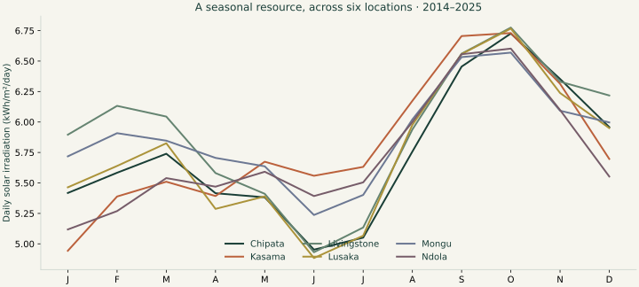
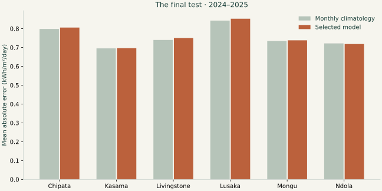

# Zambia solar resources: seasonality and a delayed-input forecast benchmark

Kenneth Gondwe Kaputula · Independent analysis · 2014–2025 source window

## Question and scope

How does the solar resource vary across six Zambian locations, and how much can a statistical forecast improve on a seasonal expectation when recent observations arrive late?

NASA POWER supplies daily global horizontal irradiation (GHI) and near-surface air temperature at reference coordinates for Lusaka, Livingstone, Ndola, Chipata, Kasama, and Mongu. These are gridded satellite/model-derived estimates. The study contains 26,298 daily location records with a complete calendar and no missing-value sentinels. The resource summary uses 2014–2025; model fitting uses the separate chronology below.

## Evaluation protocol

1. Train candidates on 2014–2020 after a 28-day feature warmup.
2. Select one model family across all cities using pooled MAE on 2021–2022. Each city has its own fitted model.
3. Refit the selected family on 2014–2022, with no later refit.
4. Use 2023 absolute residuals to calibrate a separate 80% interval radius for each city.
5. Evaluate fixed models and radii once on 2024–2025 (4,386 location-days).

Candidate definitions are fixed in source: month-of-year means; three annual Fourier harmonics with Ridge alpha 10; those harmonics plus delayed solar/temperature features with Ridge alpha 10; and two histogram boosting models with 7 or 15 leaves, 150 iterations, learning rate .05, L2 regularization 5, and no random early-stopping split. Negative forecasts are clipped at zero. All learned transformations fit on the training slice only.

| Candidate | Validation MAE (kWh/m²/day) |
| --- | ---: |
| seasonal_harmonics | 0.7332 |
| monthly_climatology | 0.7342 |
| delayed_ridge | 0.7376 |
| boosting_7 | 0.7478 |
| boosting_15 | 0.7574 |

The globally selected family is **seasonal_harmonics**. Candidate hyperparameters were not searched on the final test. Monthly climatology and an eight-day persistence benchmark remain in the final comparison even when they lose validation.

## Availability matters

Every non-calendar input is at least eight days older than its prediction date. Features include solar and temperature lags of 8, 14, 21, and 28 days, plus the mean and standard deviation of solar values from t−14 through t−8. No same-day weather is used. The source documents roughly 5–7 days of solar latency; an eight-day cutoff is an explicit assumption, not evidence that every historical release met it. Archived data may have been revised, and historical publication vintages were unavailable. This is a retrospective benchmark, not an operational forecast service.

## Final results

Selected-model MAE is **0.760 kWh/m²/day**, versus **0.755** for monthly climatology and **0.997** for eight-day persistence. Relative MAE reduction versus climatology is **-0.66%**; the paired circular seven-day block bootstrap interval is **-2.09% to 0.66%** (2,000 draws, seed 42). Shared dates are sampled across all locations, preserving spatial pairing. This interval describes sampling sensitivity within this period, not source-product uncertainty or performance in a new climate.

| Location | Model MAE | Climatology MAE | 80% interval coverage |
| --- | ---: | ---: | ---: |
| Chipata | 0.806 | 0.798 | 74.4% |
| Kasama | 0.697 | 0.695 | 74.1% |
| Livingstone | 0.750 | 0.740 | 79.3% |
| Lusaka | 0.853 | 0.843 | 74.4% |
| Mongu | 0.738 | 0.734 | 74.6% |
| Ndola | 0.719 | 0.722 | 77.2% |

Overall empirical coverage is **75.7%** at a nominal 80%; mean interval width is **2.154 kWh/m²/day**. The radius is the finite-sample corrected 80th percentile of 2023 absolute residuals, with the lower endpoint clipped to zero. Temporal dependence and distribution changes violate simple exchangeability assumptions; nominal coverage is a target, not a guarantee. Seasonal error and coverage are exported in `metrics.json`.

## What the explorer shows

Monthly bars are averages of the twelve annual monthly means; their whiskers are the 10th–90th percentiles across those twelve years. They describe interannual variability, not a confidence interval. Annual summaries are daily GHI sums averaged over years. The explorer's area/efficiency scenario multiplies irradiation by collecting area and a chosen net conversion fraction. It is a simple horizontal-plane energy calculation, not a validated PV yield model: tilt, shading, thermal behavior, inverter clipping, storage, and demand are not modeled.

## Limits and next evidence

- Six reference coordinates represent source grid cells, not local sensor installations. Nearby-site rankings should not be interpreted as precise engineering siting advice.
- Errors measure agreement with NASA POWER estimates, not with ground truth from a pyranometer or inverter.
- Calendar features can describe seasonality without anticipating unusual cloud conditions. The failed or weaker candidates remain in the validation table.
- A real forecasting deployment needs a dated archive of data availability, weather forecast inputs, and forward-only monitoring. This study does not claim electricity savings, project revenue, client outcomes, or grid reliability effects.
- The strongest extension is a permissioned local irradiance or generation series, then evaluation of bias, missingness, seasonal errors, and source-to-sensor disagreement.

## Reproduce and audit

Run `python -m src.analysis` against the committed source snapshots, then `python -m unittest discover -s tests -v` and `python scripts/sql_audit.py`. SHA-256 digests and exact request URLs are in `data/provenance.json`; predictions and calibration residual inputs are committed. `docs/index.html` is built by `python build.py`.

Data acknowledgement: NASA Langley Research Center POWER Project, funded through the NASA Earth Science Directorate Applied Science Program. Sources: [POWER daily API](https://power.larc.nasa.gov/docs/services/api/temporal/daily/), [data definitions and latency](https://power.larc.nasa.gov/docs/faqs/data/), [methodology](https://power.larc.nasa.gov/docs/methodology/). No NASA endorsement is implied.
